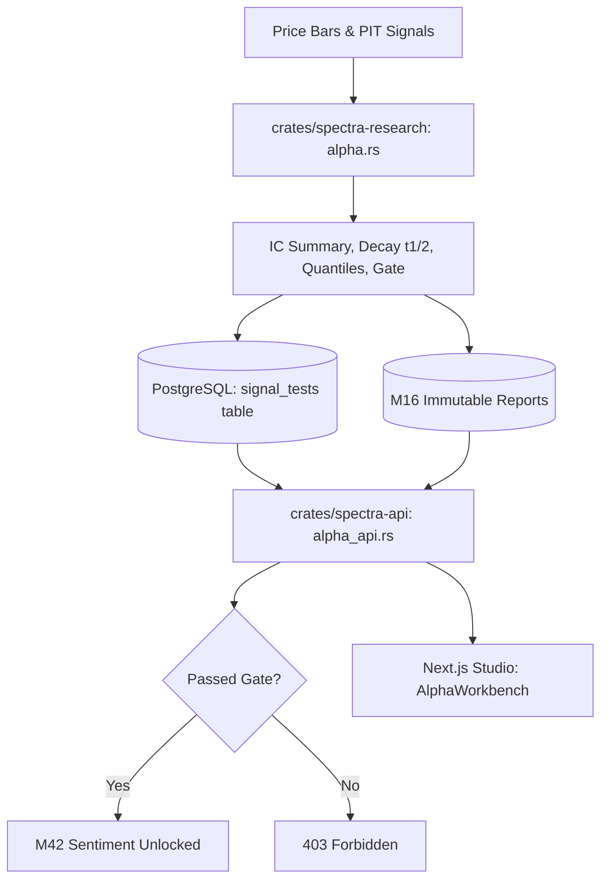

# M12 Alpha Workbench: Architecture & Implementation

**Status:** Implemented  
**Date:** November 2026  
**Module:** M12 Alpha Workbench (`crates/spectra-research`, `crates/spectra-db`, `crates/spectra-api`, `web/frontend`)  

---

## 1. Architectural Decisions (Task 0)

Before implementing the Alpha Workbench, the five fundamental architectural decisions were evaluated and recorded:

### Decision 1: Signal Evaluation Unit
- **Metric:** Cross-sectional Spearman rank correlation ($IC$) computed per date between signal values $S_{i,t}$ and forward returns $R_{i,t \to t+h}$.
- **Cross-Section Statistics:**
  - Mean IC ($\overline{IC} = \frac{1}{T} \sum_{t=1}^T IC_t$)
  - IC Standard Deviation ($\sigma_{IC} = \sqrt{\frac{1}{T-1} \sum_{t=1}^T (IC_t - \overline{IC})^2}$)
  - t-statistic ($t_{IC} = \frac{\overline{IC}}{\sigma_{IC} / \sqrt{T}}$)
- **Rank Ties:** Uses standard fractional ranking (average rank across tied values) to ensure mathematically identical results regardless of order.

### Decision 2: Signal Decay & Half-Life
- **Multi-Horizon Evaluation:** Default evaluation across 1, 5, 10, and 20 trading days.
- **Parametric Fit:**
  $$IC(h) \approx IC_0 \cdot 2^{-h / t_{1/2}}$$
  Linearized in log-space: $\ln(IC(h)) = \ln(IC_0) - \left(\frac{\ln 2}{t_{1/2}}\right) \cdot h = \beta_0 + \beta_1 h$.
  - Half-life is estimated as $t_{1/2} = -\frac{\ln 2}{\beta_1}$.
  - Handles non-decaying or non-positive horizons robustly with boundary clamps and $R^2$ goodness-of-fit.

### Decision 3: Quantile Analysis & Turnover
- **Quantile Sorting:** Partitions the cross-section into $Q$ bins (default: $Q = 5$, quintiles) on each date based on signal rank.
- **Metrics:**
  - Mean forward return per quantile: $\overline{R}_q$.
  - Top-minus-bottom spread: $\overline{R}_Q - \overline{R}_1$.
  - Top-quantile turnover: Fraction of constituents in quantile $Q$ replaced between consecutive dates:
    $$\text{Turnover}_t = 1 - \frac{|Q_{t} \cap Q_{t-1}|}{|Q_t|}$$

### Decision 4: Signal Inputs & Point-in-Time Integrity
- **Dataset Version Binding:** Tests can be bound to an immutable dataset version (`dataset_version_id`), ensuring reproducible universe and bar inputs.
- **Leakage Prevention:**
  - Signals evaluated at date $t$ must only consume price bars $\le t$.
  - Forward returns from $t$ over horizon $h$ are computed strictly using close prices from $t$ to $t+h$:
    $$R_{i, t \to t+h} = \frac{P_{i, t+h}}{P_{i, t}} - 1$$
  - Leakage verification test proves that altering or appending price bars after date $t$ has zero effect on the signal value or forward returns from date $t$.

### Decision 5: Owner Gate Thresholds & Module Blocking
- **Gate Enforcement:**
  - Evaluates signal viability against owner-configurable thresholds:
    - Minimum Mean IC (e.g. $\overline{IC} \ge 0.03$)
    - Minimum t-statistic (e.g. $t_{IC} \ge 2.0$)
    - Minimum / Maximum decay half-life
  - If a signal fails the threshold, `passed_gate` is `false` with explicit diagnostic rejection reasons.
- **Downstream Module Blocking:**
  - M42 sentiment scores (`GET /api/v1/alpha/m42/sentiment`) are gated: if the workspace lacks a passing signal test, the API blocks access with `403 Forbidden` and details indicating that a viable signal test is required.

---

## 2. System Architecture

### Modules
1. **`crates/spectra-research/src/alpha.rs`**: Pure mathematical signal processing:
   - Builtin signal generation (`momentum_5d`, `mean_reversion_5d`, `sma_crossover_10_30`).
   - Fractional ranking, Spearman rank correlation, t-statistic.
   - Exponential half-life regression.
   - Quantile distribution and constituent turnover.
   - Deterministic JSON and CSV report serialization.
2. **`crates/spectra-db`**:
   - Migration `20261107000001_signal_tests.sql`: Altered `reports` CHECK constraint for `'signal_test'` and created `signal_tests` table.
   - Entity `signal_tests.rs`: Workspace-isolated CRUD, counts, and latest passed test checks.
3. **`crates/spectra-api`**:
   - Endpoints:
     - `POST /api/v1/alpha/signal-tests` (Editor/Admin)
     - `GET /api/v1/alpha/signal-tests` (Viewer+)
     - `GET /api/v1/alpha/signal-tests/{id}` (Viewer+)
     - `GET /api/v1/alpha/signal-tests/{id}/export` (Editor/Admin, PDF/JSON/CSV via M16)
     - `GET /api/v1/alpha/m42/sentiment` (Gated, checks passing tests)
4. **`web/frontend`**:
   - `components/studio/AlphaWorkbench.tsx`: Interactive studio workspace.
   - Prominent disclaimer: `"research only, not a prediction"`.
   - Overfitting guard: Displays total tests run against the dataset version with elevated testing warnings.
   - M16 Report integration via `<SignalTestReportPanel />`.

---

## 3. Verification & Compliance
- **Leakage Prevention Test:** Verified by `tests/m12_alpha_workbench.rs::test_leakage_prevention_signal_and_forward_returns`.
- **Known-Answer IC Test:** Verified with synthetic data yielding known rank correlation $1.0$.
- **Decay Half-Life Test:** Verified with synthetic exponential decay yielding exact known half-life.
- **Quantile Spread & Turnover Test:** Verified with monotonic quantile sorting and constituent turnover.
- **Determinism Test:** Verified that identical inputs yield identical outputs and sha256 checksums.
- **Workspace Isolation & Gate Test:** Verified by `tests/alpha_flow.rs` ensuring workspace isolation, role checks, and 403 blocking of M42 sentiment scores when gate fails.
